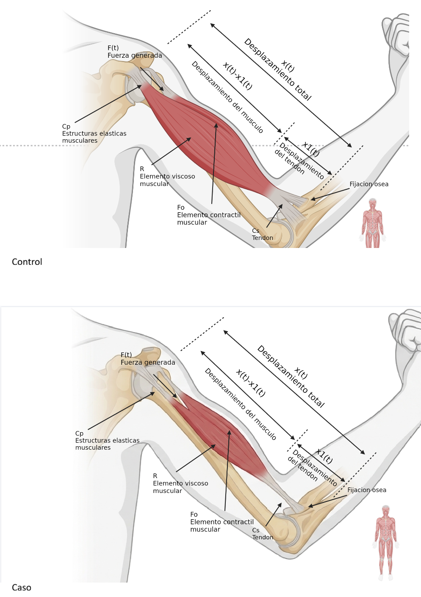
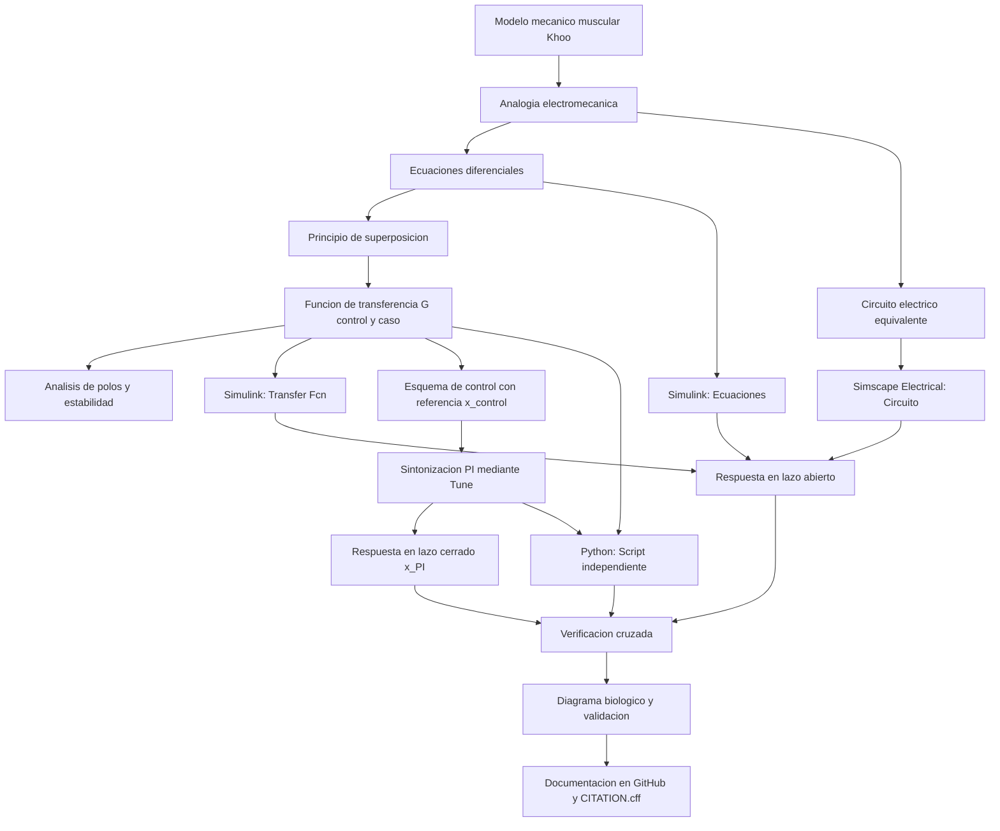

[](https://matlab.mathworks.com/open/github/v1?repo=moglyy/MSFP3)
# Práctica 3 — Modelado y control del sistema musculoesquelético

Esta práctica integra el modelado viscoelástico del tejido muscular, la analogía electromecánica fuerza-voltaje, el análisis matemático analítico mediante el principio de superposición, el análisis temporal y de estabilidad, la simulación computacional de la patología de atrofia muscular, el diseño y sintonización de un controlador PI *in silico*, y la verificación cruzada mediante MATLAB, Simulink, Simscape Electrical y Python.

El caso de estudio representa la **dinámica musculoesquelética** mediante el modelo viscoelástico simplificado descrito por M. C. Khoo. Se busca analizar y comparar la respuesta de la deformación/fuerza transmitida ante una excitación de fuerza $F(t)$ en un individuo sano (control) contra un paciente con atrofia muscular (caso), implementando un esquema de control por retroalimentación para reducir la discrepancia entre ambas respuestas.

**Docente:** Dr. Paul Antonio Valle Trujillo  
**Correo:** paul.valle@tectijuana.edu.mx  
**Departamento:** Ingeniería Eléctrica y Electrónica  
**Institución:** Tecnológico Nacional de México / Instituto Tecnológico de Tijuana  
**Asignatura:** Modelado de Sistemas Fisiológicos  
**Programa:** Ingeniería Biomédica  
**Estudiante:** Kiara Vianney Trinidad Diaz · 23212240 · L23212240@tijuana.tecnm.mx

**Sede:** Blvd. Alberto Limón Padilla s/n, Tijuana, C. P. 22454, B. C., México.

## Contenido

 1. [Resumen](#resumen)
 2. [Competencia y objetivos](#objetivos)
 3. [Relación con el temario](#temario)
 4. [Modelo físico y analogía electromecánica](#analogia)
 5. [Formulación y análisis matemático detallado](#modelo)
 6. [Análisis temporal y de estabilidad](#analisis)
 7. [Condiciones de simulación y señales](#senales)
 8. [Implementación en MATLAB, Simulink y Simscape](#matlab)
 9. [Estrategia de control in silico y sintonización PI](#pi)
10. [Diagrama biológico y correspondencia fisiológica](#biologico)
11. [Resultados y verificación cruzada](#resultados)
12. [Flujo de trabajo](#flujo)
13. [Actividades del estudiante](#actividades)
14. [Estructura del repositorio](#estructura)
15. [Requisitos](#requisitos)
16. [Reproducibilidad y entregables](#reproducibilidad)
17. [Referencias](#referencias)

## Resumen

Esta práctica tiene como propósito **modelar, analizar, simular y controlar la respuesta dinámica del sistema musculoesquelético** ante excitaciones de fuerza. Se aborda la caracterización del tejido pasivo y activo empleando una combinación de compliancias ($C_s$ y $C_p$) y amortiguación viscosa ($R$). Mediante la **analogía fuerza-voltaje**, el sistema mecánico se transforma en un circuito eléctrico equivalente para analizar su comportamiento dinámico.

A partir del **principio de superposición**, se deducen analíticamente las componentes de respuesta parciales $F_{s1}(t)$ y $F_{s2}(t)$ debidas a la fuerza externa $F(t)$ y la fuerza activa interna $F_0(t) = \alpha F(t)$, obteniendo la función de transferencia global $G(s) = \frac{F_s(s)}{F(s)}$. Se evalúa la condición de un **individuo sano (control)** y se simula una condición de **atrofia muscular (caso)** caracterizada por un incremento drástico en el amortiguamiento viscoso ($R$). Se realiza el análisis de estabilidad y error en estado estacionario. Posteriormente, se implementa un **controlador PI *in silico*** tomando la respuesta del individuo sano como señal de referencia. Todos los modelos se validan en MATLAB, Simulink, Simscape Electrical y Python.

**Palabras clave:** Sistema musculoesquelético; Modelado matemático; Analogía fuerza-voltaje; Función de transferencia; Controlador PI; Atrofia muscular.

## Competencia y objetivos

### Competencia a desarrollar

Modelizar sistemas fisiológicos mediante analogías entre sistemas físicos, ecuaciones diferenciales y funciones de transferencia para analizar su comportamiento dinámico y diseñar estrategias de control mediante técnicas de control clásico. En particular, analizar el sistema musculoesquelético, construir su circuito eléctrico equivalente, comparar la respuesta de un individuo sano (control) con un caso simulado de atrofia muscular (caso) y diseñar una estrategia de control *in silico* orientada a reducir las diferencias entre ambas respuestas.

### Objetivo general

Obtener el modelo matemático explícito y circuito equivalente de un compartimento musculoesquelético mediante superposición, simular la respuesta dinámica de un individuo sano y de un paciente con atrofia muscular, y diseñar un sistema de control *in silico* mediante sintonización PI para reducir el error entre la respuesta del caso y la referencia del control.

### Objetivos específicos

* Identificar los componentes viscoelásticos ($F_0$, $F$, $R$, $C_s$, $C_p$) del modelo mecánico muscular.
* Formular la conversión al circuito eléctrico equivalente aplicando la analogía fuerza-voltaje.
* Aplicar el principio de superposición para apagar $F_0(t)$ y $F(t)$ secuencialmente y deducir la función de transferencia global $G(s) = \frac{F_s(s)}{F(s)}$.
* Calcular el error en estado estacionario $e_{ss}$ y los polos del sistema en lazo abierto.
* Implementar la simulación en Simulink (`sistema4.slx`) mediante ecuaciones diferenciales, función de transferencia y componentes físicos de Simscape Electrical.
* Diseñar la estrategia de control por retroalimentación negativa donde la referencia es la salida del individuo sano $x_{\text{control}}(t)$.
* Sintonizar las ganancias del controlador PI ($k_P$, $k_I$) mediante la herramienta *Tune*.
* Validar y comparar numéricamente los resultados utilizando cuadernos computacionales de MATLAB (`Trinidad23212240.mlx`) y scripts en Python (`Trinidad23212240.py`).

## Relación con el temario

La práctica integra contenidos pertenecientes a la asignatura **Modelado de Sistemas Fisiológicos (IBF-1020)**:

| Unidad | Área | Contenidos aplicados | 
| ----- | ----- | ----- | 
| **I** | Sistemas de control retroalimentados | Diagramas de bloques, señales de referencia, seguimiento de trayectoria y criterios de estabilidad | 
| **II** | Modelado matemático | Analogías electromecánicas (fuerza-voltaje), superposición de fuentes, ecuaciones integro-diferenciales y funciones de transferencia | 
| **III** | Controladores | Tipos de controladores (PI), sintonización *in silico* de ganancias y reducción del error | 

## Modelo físico y analogía electromecánica

El modelo mecánico simplificado del compartimento muscular consta de una fuerza activa $F_0(t) = \alpha F(t)$ ($0 < \alpha < 1$), un elemento elástico en serie $C_s$, un amortiguador viscoso $R$ y un elemento elástico en paralelo $C_p$.

### Tabla de analogía fuerza-voltaje

| Sistema mecánico | Sistema eléctrico equivalente | 
| ----- | ----- | 
| Fuerza $F(t)$ | Voltaje $V(t)$ | 
| Velocidad $\frac{dx(t)}{dt}$ | Corriente $I(t)$ | 
| Desplazamiento $x(t)$ | Carga eléctrica $q(t)$ | 
| Amortiguador ($R$) | Resistencia ($R$) | 
| Compliancia mecánica ($C$) | Capacitancia ($C$) | 
| Masa ($M$) | Inductancia ($L$) | 

### Parámetros del modelo (Control vs. Caso)

Para la simulación *in silico*, el deterioro muscular por atrofia se representa mediante el incremento en el parámetro de amortiguamiento viscoso ($R$):

| Parámetro | Individuo sano (Control) | Paciente (Caso: Atrofia) | Unidad eléctrica | 
| ----- | ----- | ----- | ----- | 
| Fuerza aplicada $F(t)$ | $1$ | $1$ | $\mathrm{V}$ | 
| Fuerza activa $\alpha$ | $0.25$ | $0.25$ | Adimensional | 
| Compliancia serie $C_s$ | $10\times10^{-6}$ | $10\times10^{-6}$ | $\mathrm{F}$ ($10\,\mu\mathrm{F}$) | 
| Compliancia paralelo $C_p$ | $100\times10^{-6}$ | $100\times10^{-6}$ | $\mathrm{F}$ ($100\,\mu\mathrm{F}$) | 
| Amortiguamiento $R$ | $100$ | $10\,000$ | $\Omega$ ($10\,\mathrm{k}\Omega$) | 

## Formulación y análisis matemático detallado

El desarrollo matemático explícito de esta práctica se encuentra resguardado en el documento manuscripto [`AnalisisMatematicoP3.pdf`](AnalisisMatematicoP3.pdf). De acuerdo con el análisis del sistema eléctrico equivalente y considerando el desplazamiento total $x(t) = x_1(t) + x_2(t)$, se aplica el **Principio de Superposición** para encontrar la fuerza total transmitida $F_s(t) = F_{s1}(t) + F_{s2}(t)$.

### 1. Circuito 1: Apagando $F_0(t)$

Al apagar la fuente interna $F_0(t) = 0$, se analiza la contribución de $F(t)$ al nodo $F_{s1}(t)$:

$$
x(t) = C_p \frac{d F_{s1}(t)}{dt}, \quad x_1(t) = C_s \frac{d[F(t) - F_{s1}(t)]}{dt}, \quad x_2(t) = \frac{F(t) - F_{s1}(t)}{R}
$$

Igualando las relaciones de velocidad y desplazamiento en el nodo:

$$
C_p \frac{d F_{s1}(t)}{dt} = C_s \frac{d[F(t) - F_{s1}(t)]}{dt} + \frac{F(t) - F_{s1}(t)}{R}
$$

Aplicando la transformada de Laplace con condiciones iniciales nulas:

$$
C_p s F_{s1}(s) = C_s s [F(s) - F_{s1}(s)] + \frac{F(s) - F_{s1}(s)}{R}
$$

Reagrupando términos para $F_{s1}(s)$ y $F(s)$:

$$
\left( C_p s + C_s s + \frac{1}{R} \right) F_{s1}(s) = \left( C_s s + \frac{1}{R} \right) F(s)
$$

Multiplicando por $R$ ambos lados:

$$
\boxed{F_{s1}(s) = \frac{C_s R s + 1}{R(C_p + C_s)s + 1} F(s)}
$$

### 2. Circuito 2: Apagando $F(t)$

Al apagar la fuente externa $F(t) = 0$, se analiza la contribución de la fuente activa $F_0(t) = \alpha F(t)$:

$$
-\alpha F(t) = R x(t) + \frac{1}{C_p + C_s} \int x(t)\,dt
$$

La fuerza producida en este modo es $F_{s2}(t) = \frac{1}{C_p + C_s} \int x(t)\,dt$. En el dominio de Laplace:

$$
-\alpha F(s) = R X(s) + \frac{X(s)}{(C_p + C_s)s} \implies F(s) = -\frac{1}{\alpha} \frac{R(C_p + C_s)s + 1}{(C_p + C_s)s} X(s)
$$

Despejando $F_{s2}(s)$ en función de $F(s)$:

$$
\frac{F_{s2}(s)}{F(s)} = \frac{\frac{X(s)}{(C_p + C_s)s}}{-\frac{1}{\alpha}\frac{R(C_p + C_s)s + 1}{(C_p + C_s)s} X(s)} = -\frac{\alpha}{R(C_p + C_s)s + 1}
$$

$$
\boxed{F_{s2}(s) = -\frac{\alpha}{R(C_p + C_s)s + 1} F(s)}
$$

### 3. Función de transferencia global

Sumando las componentes parciales $F_s(s) = F_{s1}(s) + F_{s2}(s)$:

$$
\boxed{G(s) = \frac{F_s(s)}{F(s)} = \frac{C_s R s + 1 - \alpha}{R(C_p + C_s)s + 1}}
$$

## Análisis temporal y de estabilidad

### 1. Error en estado estacionario

Aplicando el Teorema del Valor Final para una entrada escalón unitario $F(s) = \frac{1}{s}$:

$$
e_{ss} = \lim_{s \to 0} s F(s) \left[ 1 - \frac{F_s(s)}{F(s)} \right] = 1 - \frac{1 - \alpha}{1} = \boxed{\alpha}
$$

Dado que $\alpha = 0.25$, existe un error en estado estacionario permanente en lazo abierto del $25\%$.

### 2. Estabilidad en lazo abierto

El polo del sistema se determina igualando el denominador a cero:

$$
R(C_p + C_s)s + 1 = 0 \implies \boxed{\lambda = -\frac{1}{R(C_p + C_s)}}
$$

* **Sujeto Sano (Control):** $R = 100\,\Omega \implies \lambda_{\text{control}} \approx -90.91\,\mathrm{s}^{-1}$ (Estable, respuesta rápida).
* **Paciente (Caso Atrofia):** $R = 10\,000\,\Omega \implies \lambda_{\text{caso}} \approx -0.909\,\mathrm{s}^{-1}$ (Estable, respuesta lenta).

## Condiciones de simulación y señales

Las simulaciones se realizan nominalmente en un intervalo de tiempo $t \in [0, 10]\,\mathrm{s}$.

| Señal de entrada | Propósito en el experimento *in silico* | 
| ----- | ----- | 
| **Impulso unitario** | Evaluar la respuesta natural del sistema musculoesquelético y comparar la dinámica del sujeto sano vs atrofia. | 

## Implementación en MATLAB, Simulink y Simscape

Se construyen tres representaciones equivalentes dentro del modelo [`sistema4.slx`](sistema4.slx):

1. **Ecuaciones diferenciales:** Bloques matemáticos e integradores en Simulink.
2. **Función de transferencia:** Bloque `Transfer Fcn` configurado con $G(s) = \frac{C_s R s + 1 - \alpha}{R(C_p + C_s)s + 1}$.
3. **Circuito físico equivalente:** Ensamble de componentes pasivos mediante Simscape Electrical.

## Estrategia de control in silico y sintonización PI

Se utiliza la respuesta del individuo sano $x_{\text{control}}(t)$ como el perfil de movimiento deseado. La señal de error es $e(t) = x_{\text{control}}(t) - x_{\text{caso}}(t)$.

El controlador PI procesa esta diferencia y aplica la acción de control $u(t)$:

$$
u(t) = k_P e(t) + k_I \int_0^t e(\tau)\,d\tau
$$


Utilizando el afinador del bloque `PID Controller` de Simulink (configurado en modo PI), se sintonizan $k_P$ y $k_I$ buscando estabilizar el sistema. La evidencia y las ganancias se incluyen en [`gananciasPI.png`](gananciasPI.png).

## Diagrama biológico y correspondencia fisiológica

El siguiente esquema elaborado en BioRender ilustra la correspondencia anatómica y las variables mecánicas empleadas para la analogía eléctrica, detallando la diferencia entre el estado saludable del músculo y la alteración originada por atrofia muscular que provoca un incremento en la viscosidad.

<div align="center">
  
  <p><em>Comparación anatómica: Sujeto Sano vs. Atrofia Muscular (Caso).</em></p>
</div>

| Elemento mecánico | Equivalente eléctrico | Estructura biológica asociada | 
| ----- | ----- | ----- | 
| **Fuerza activa** $F_0(t)$ | Fuente de voltaje | Contracción activa por acoplamiento miosina-actina | 
| **Compliancia serie** $C_s$ | Capacitancia $C_s$ | Tendón y elementos elásticos en serie | 
| **Compliancia paralelo** $C_p$ | Capacitancia $C_p$ | Sarcolema y tejido conectivo pasivo | 
| **Amortiguamiento** $R$ | Resistencia $R$ | Viscosidad sarcoplásmica y fricción tisular interna | 

## Resultados y verificación cruzada

Se comparan las curvas temporales para las tres condiciones:
* **Línea Azul:** Individuo Sano (Control de Referencia).
* **Línea Roja:** Paciente con Atrofia (Caso en Lazo Abierto).
* **Línea Verde:** Paciente Tratado (Caso con Controlador PI).

### Archivos de resultados del repositorio

| Simulación / Evidencia | Archivo en el repositorio | 
| ----- | ----- | 
| Análisis analítico manuscrito | [`AnalisisMatematicoP3.pdf`](AnalisisMatematicoP3.pdf) | 
| Captura de sintonización de ganancias PI | [`gananciasPI.png`](gananciasPI.png) | 
| Diagrama biológico de correspondencia | [`Musculoesqueletico_2.jpg`](Musculoesqueletico_2.jpg) | 
| Respuestas al impulso en MATLAB | [`Control y caso.matlab.pdf`](Control%20y%20caso.matlab.pdf) | 
| Respuestas al impulso en Python | [`Musculoesqueletico_python.pdf`](Musculoesqueletico_python.pdf) | 

## Flujo de trabajo



## Actividades del estudiante

### Etapa 1. Análisis analítico
* [x] Identificar la función de $F_0, F, R, C_s, C_p, x(t)$.
* [x] Construir el circuito equivalente mediante analogía fuerza-voltaje.
* [x] Derivar $G(s)$ por superposición apagando $F_0(t)$ y $F(t)$ ([`AnalisisMatematicoP3.pdf`](AnalisisMatematicoP3.pdf)).
* [x] Demostrar $e_{ss} = \alpha$ y hallar los polos $\lambda$.

### Etapa 2. Simulación computacional
* [x] Construir el modelo en Simulink ([`sistema4.slx`](sistema4.slx)).
* [x] Implementar el circuito equivalente en Simscape Electrical.
* [x] Obtener la respuesta al impulso en lazo abierto ($t \in [0, 10]\,\mathrm{s}$).

### Etapa 3. Control y verificación in silico
* [x] Implementar retroalimentación con referencia $x_{\text{control}}(t)$.
* [x] Sintonizar $k_P, k_I$ con la herramienta *Tune* ([`gananciasPI.png`](gananciasPI.png)).
* [x] Exportar la figura de MATLAB ([`Control y caso.matlab.pdf`](Control%20y%20caso.matlab.pdf)) y ejecutar el script en Python ([`Trinidad23212240.py`](Trinidad23212240.py)).

### Etapa 4. Documentación
* [x] Incluir el diagrama biológico de BioRender ([`Musculoesqueletico_2.jpg`](Musculoesqueletico_2.jpg)).
* [x] Publicar el repositorio con sus fuentes y archivo [`CITATION.cff`](CITATION.cff).

## Estructura del repositorio

```
.
├── AnalisisMatematicoP3.pdf      # Demostracion analitica manuscrita por superposicion
├── CITATION.cff                  # Fichero de citacion academica del repositorio
├── Control y caso.matlab.pdf     # Exportacion grafica de simulacion en MATLAB
├── LICENSE                       # Licencia BSD 2-Clause del repositorio
├── Musculoesqueletico_2.jpg      # Diagrama biologico de correspondencia (BioRender)
├── Musculoesqueletico_python.pdf # Exportacion grafica de simulacion en Python
├── README.md                     # Reporte academico principal de la practica
├── Trinidad23212240.mlx          # Cuaderno computacional Live Script de MATLAB
├── Trinidad23212240.pdf          # Exportacion en PDF del cuaderno Live Script
├── Trinidad23212240.py           # Script ejecutable en Python (VS Code)
├── gananciasPI.png               # Evidencia de la sintonizacion del controlador PI
└── sistema4.slx                  # Modelo de Simulink / Simscape Electrical
```

## Requisitos

### Software
* **MATLAB** con Simulink, Simscape Electrical y Control System Toolbox.
* **Python 3.x** en Visual Studio Code (`numpy`, `scipy`, `matplotlib`).
* **Git y GitHub** para la gestión y presentación del repositorio.

## Reproducibilidad y entregables

1. Demostración analítica por superposición de $G(s) = \frac{C_s R s + 1 - \alpha}{R(C_p + C_s)s + 1}$ registrada en [`AnalisisMatematicoP3.pdf`](AnalisisMatematicoP3.pdf).
2. Cálculo de polos y demostración de $e_{ss} = \alpha$.
3. Modelo de Simulink [`sistema4.slx`](sistema4.slx) con representaciones en lazo abierto y cerrado.
4. Ganancias PI sintonizadas registradas en [`gananciasPI.png`](gananciasPI.png).
5. Cuaderno computacional [`Trinidad23212240.mlx`](Trinidad23212240.mlx) y ejecutable de Python [`Trinidad23212240.py`](Trinidad23212240.py).
6. Figuras de resultados en PDF: [`Control y caso.matlab.pdf`](Control%20y%20caso.matlab.pdf) y [`Musculoesqueletico_python.pdf`](Musculoesqueletico_python.pdf).
7. Diagrama biológico incrustado y documentado con [`Musculoesqueletico_2.jpg`](Musculoesqueletico_2.jpg) y archivo [`CITATION.cff`](CITATION.cff).

## Referencias

\[1\] M. C. Khoo, *Physiological Control Systems: Analysis, Simulation, and Estimation*, 2nd ed., IEEE Press, 2018.  
\[2\] F. C. Hoppensteadt y C. S. Peskin, *Modeling and Simulation in Medicine and the Life Sciences*, Springer.  
\[3\] J. E. Hall, *Guyton and Hall Textbook of Medical Physiology*, 14th ed., Elsevier, 2021.  
\[4\] K. Ogata, *Ingeniería de Control Moderna*, 5.ª ed., Pearson Educación, 2010.  
\[5\] P. A. Valle, *Syllabus para Modelado de Sistemas Fisiológicos*, Tecnológico Nacional de México / Instituto Tecnológico de Tijuana, 2026. Disponible en: https://biomath.xyz/course/

## Uso académico

Este repositorio se utiliza como evidencia de la **Práctica 5.5: Modelado y control del sistema musculoesquelético**. Su finalidad es aplicar principios de modelado viscoelástico, analogías físicas y diseño de control *in silico* para la evaluación de condiciones fisiopatológicas.
